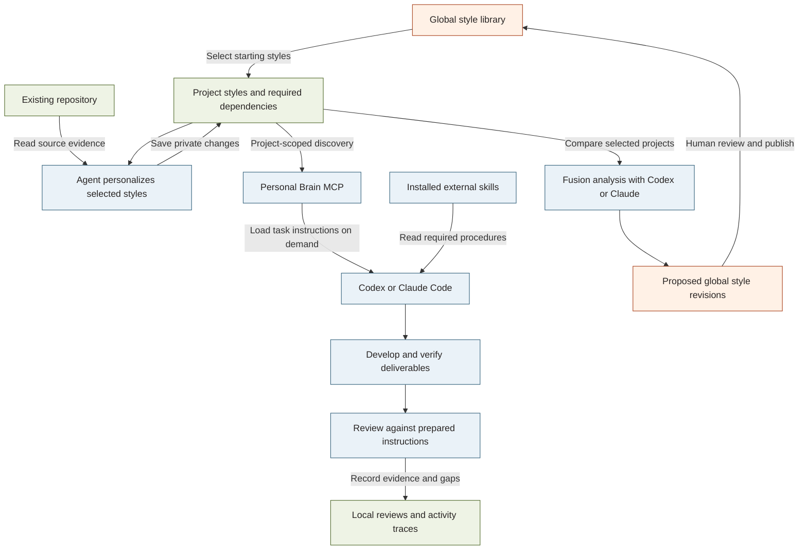

# Personal Brain

Local-first working styles for Codex, Claude Code and ChatGPT. Manage reusable styles, project-private instructions, required skills, examples and review criteria through a browser UI and MCP.

## How it works

Choose shared styles, adapt them privately to your repository, and let your agent retrieve the instructions needed for each task. Fusion brings reusable lessons back to the shared library after your review.



**Legend:** orange = shared styles and proposals; green = project context and records; blue = agent workflow. Arrows show information flow or an explicit action. Styles and review evidence are stored locally in SQLite. Fusion sends selected instructions to the chosen agent provider; publishing updates shared styles without overwriting private copies. Recorded reviews do not prove that an agent followed every instruction.

## Install

Requires Node.js 22.13+; Node 24 LTS is recommended. This is a beta package; the commands below become available after publication.

```sh
npm install -g personal-brain-style@beta
personal-brain setup
```

Open http://127.0.0.1:4177. Setup starts the local workspace; create a project, select styles and link its repository in the UI. It does not change agent configuration automatically. Keep the process running while using the browser UI.

For a temporary preview: `npx personal-brain-style@beta setup`. Use a stable global installation before registering agent hooks.

## Fresh-install global styles

The first start with a new data directory installs the bundled global library: 18 styles and four linked review records, including the current UI/UX guidelines. This works with `personal-brain setup`, `personal-brain mcp` and `personal-brain seed`. Dependencies receive local IDs. External skill references are included; skill software must be installed separately.

Existing libraries and edits are preserved. Restarting does not reset styles or add deleted records. The release catalog contains no projects, private styles, conversations, audit history or tool credentials. It is a release snapshot, not synchronization between computers. Maintainers update `src/styles/global-style-catalog.ts` from reviewed global records before releasing changes.

## Create a project

Open **Projects → New Project**. The wizard guides you through:

1. **Project & folder:** enter a name, then use **Browse folders** to select an existing repository on the computer running Personal Brain, or paste its absolute path. The standard operating-system folder dialog opens on the server computer; no files are uploaded. Linux requires Zenity and a graphical session. If a dialog cannot open, paste the path instead. Already-linked folders are rejected without changing their links.
2. **Discover & personalize with AI:** optionally ask an installed, signed-in Codex or Claude CLI to recommend styles and draft project-specific guidelines. This sends bounded repository evidence and style guidelines to the chosen provider. Review the reasons and proposed guidelines on each card, then choose **Use suggestion**. Adaptations preserve the base guidelines and are saved as project-only overrides; global styles stay unchanged. You can cancel, retry or continue manually.
3. **Select styles:** search immediately by name, capability or keyword. Selected styles remain visible; customization drafts survive search and Back navigation.
4. **Review:** check the folder and selections, then create the project and repository link. Required dependencies are validated before saving.

AI discovery uses repository instructions, README and build manifests, not an exhaustive code review. Existing projects use the same workflow through **Repository setup → Discover & personalize with AI**, then save their reviewed selections. Closing or reloading an unfinished wizard discards its unsaved draft after the browser's leave warning.

## Connect your agent

```sh
codex mcp add personal-brain -- personal-brain mcp codex
claude mcp add --transport stdio --scope user personal-brain -- personal-brain mcp claude
personal-brain hooks install both
```

Restart your agent and approve hooks where required. Ensure its environment can find the installed personal-brain command. The UI provides repository linking and project personalization instructions. External skills are references; they must be installed separately.

For ChatGPT, open Agent setup and select a project. See [ChatGPT connection](docs/CHATGPT.md). OpenAI tunnel access and workspace authorization are required. The helper currently requires Bash.

## Claude Desktop: local installation

From this repository, use Linux/macOS Bash or Windows **Git Bash with native Windows Node.js**:

```sh
bash scripts/activate-personal-brain.sh --desktop
bash scripts/activate-personal-brain.sh --repair --desktop
bash scripts/activate-personal-brain.sh --status --desktop
```

The first command previews the configuration. Repair creates or refreshes this installation's Desktop MCP entry, backs up existing configuration, and preserves other servers. Fully quit and reopen Claude Desktop afterward. It launches its own MCP process; `npm start` remains the separate browser UI server.

Without Bash, including Windows PowerShell, use the same installer through npm:

```sh
npm run cli -- desktop repair
npm run cli -- desktop status
npm run cli -- desktop remove
```

Optionally append `--project YOUR_PROJECT_ID` to set a default project, or `--config "ABSOLUTE_CONFIG_PATH"` to use the file shown by Claude Desktop's Edit Config. Defaults are `%APPDATA%/Claude/claude_desktop_config.json` on Windows, `$XDG_CONFIG_HOME/Claude/claude_desktop_config.json` (or `~/.config/Claude/`) on Linux, and `~/Library/Application Support/Claude/claude_desktop_config.json` on macOS. Alternate Windows/MSIX or Linux installations may require `--config`. Use native Windows Node for Windows Desktop; running inside WSL targets Linux paths and is not a Windows Desktop installation.

The `--desktop` option does not install Claude Code/Codex hooks. Existing activation commands without it retain their CLI-agent behavior. Configuration success is not proof of a live Desktop connection; check the server status in Claude Desktop after restarting.

## Fusion and project instructions

Use **Fusion** to compare effective project instructions and review proposed shared-style revisions. Agents can use `brain_prepare` to load a version-bound task instruction set, then `brain_review` to check the same set before completion. See [Fusion and instruction workflow](docs/FUSION-AND-INSTRUCTIONS.md) for research decisions, examples and verification limits.

## Data and upgrades

Data stays in ~/.personal-brain-style by default; PB_HOME selects another directory. The package contains no user database, credentials or installed third-party skill files. Startup installs built-in starter styles; review them before selecting them for a project.

```sh
personal-brain backup /absolute/path/brain-backup.sqlite
npm install -g personal-brain-style@beta
personal-brain doctor
```

Stop the running server before upgrading. Restart afterward. Reinstall hooks if the installation path changes. Keep backups before upgrades; do not run an older version against a migrated database.

To uninstall, run `personal-brain hooks remove both`, remove the personal-brain MCP entry from each agent, then `npm uninstall -g personal-brain-style`. Your database is preserved. Removing the data folder is a separate, destructive action.

## Development

Source is grouped by responsibility, with one stable CLI entry point:

```text
src/
  cli.ts          CLI entry point for local and packaged execution
  core/           Models, validation, ranking metadata and SQLite storage
  projects/       Project scope, repository evidence and skill discovery
  instructions/   Task preparation, compliance, review and Fusion
  agents/         MCP transport, agent hooks and external tool bridge
  server/         Local HTTP API and static file serving
  styles/         Built-in style catalog, seeds and versioned upgrades
web/              Browser TypeScript source
public/           HTML, CSS and generated browser JavaScript
scripts/          Development, packaging and agent setup commands
tests/            Behavior and regression tests
examples/         Sample style catalog
docs/             Architecture, workflows and operating guides
dist/             Generated npm package contents (do not edit)
```

Keep agent and HTTP adapters thin; place shared behavior in the relevant source module. Update importing tests when moving a module. Keep the `src/cli.ts` entry point stable for existing agent registrations. The package build recursively compiles source modules and preserves their directory layout.


```sh
npm install
npm run build:package
npm test
npm pack
node scripts/test-package.mjs
```

The npm artifact includes compiled JavaScript and the prebuilt browser UI. No runtime npm dependencies are required. The CLI and UI run locally on loopback; retrieved content is shared with the agent provider when requested. Trace events show observed activity, not proof of model compliance.

MIT licensed. See [platform verification and remaining Windows/macOS checks](docs/PLATFORM-SUPPORT.md). Native platform CI is configured; results must be checked before claiming full compatibility.

## Project and support

Source: [nghiacr002/personal-brain-style](https://github.com/nghiacr002/personal-brain-style). Report reproducible problems through [GitHub Issues](https://github.com/nghiacr002/personal-brain-style/issues).

Package discovery keywords are maintained in `package.json`; npm displays them after the next published version. They describe MCP, agent instructions, skills, project styles and Fusion.

### Create project-private styles through MCP

Agents can call `brain_create_project_style` with an explicit `projectId`, the current `expectedProjectVersion` from `brain_projects`, and a `style` containing `keyId` (a stable lowercase slug), `domain`, `title`, `summary` and `content`. Optional fields include skill references, examples, review criteria and required style IDs. The capability must already exist.

The style is private to that project and selected by default. Use `select: false` to save an unselected alternative. If that capability already has a selected style, update it with `brain_update_project_style` or change the selection in Configure project. Matching uses the immutable `keyId`, not the display title. A global match is selected and personalized for the project; a private match is updated rather than duplicated. Different projects can own the same private key until publishing establishes its global identity. Publishing reuses an existing global key and never overwrites its content; private variants retain their content and link to the global style. Global edits belong in the Library or Fusion review workflow. New keys are generated from the title when omitted. The editor displays the key and locks it after creation. Existing conflicting legacy records retain distinct keys and their original content/history. Restart an existing MCP connection to discover the new tool; the ChatGPT read-only connection does not expose it.
