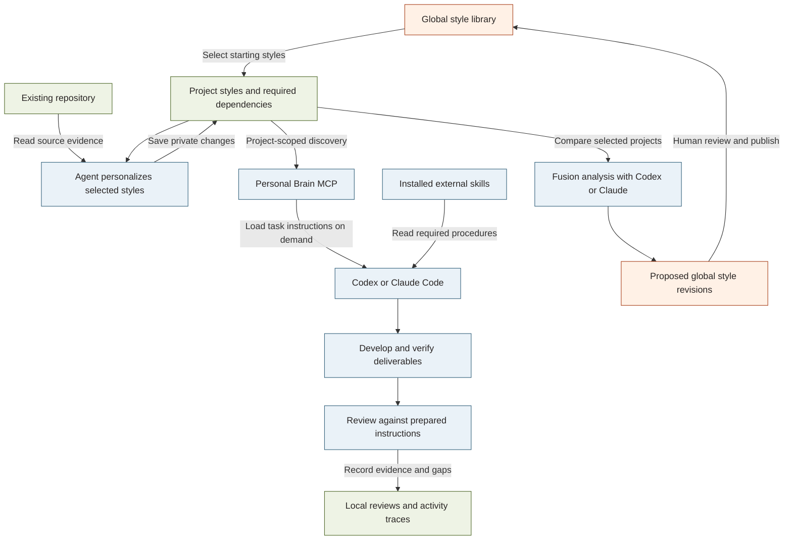

# Personal Brain

Local-first working styles for Codex, Claude Code and ChatGPT. Manage reusable styles, project-private instructions, required skills, examples and review criteria through a browser UI and MCP.

## How it works

Choose shared styles, adapt them privately to your repository, and let your agent retrieve the instructions needed for each task. Fusion brings reusable lessons back to the shared library after your review.



**Legend:** orange = shared styles and proposals; green = project context and records; blue = agent workflow. Arrows show information flow or an explicit action. Styles and review evidence are stored locally in SQLite. Fusion sends selected instructions to the chosen agent provider; publishing updates shared styles without overwriting private copies. Recorded reviews do not prove that an agent followed every instruction.

## Install

Requires Node.js 22.13+; Node 24 LTS is recommended. This is a beta package; the commands below become available after publication.

```sh
npm install -g personal-brain-style@beta
personal-brain setup
```

Open http://127.0.0.1:4177. Setup starts the local workspace; create a project, select styles and link its repository in the UI. It does not change agent configuration automatically. Keep the process running while using the browser UI.

For a temporary preview: `npx personal-brain-style@beta setup`. Use a stable global installation before registering agent hooks.

## Connect your agent

```sh
codex mcp add personal-brain -- personal-brain mcp codex
claude mcp add --transport stdio --scope user personal-brain -- personal-brain mcp claude
personal-brain hooks install both
```

Restart your agent and approve hooks where required. Ensure its environment can find the installed personal-brain command. The UI provides repository linking and project personalization instructions. External skills are references; they must be installed separately.

For ChatGPT, open Agent setup and select a project. See [ChatGPT connection](docs/CHATGPT.md). OpenAI tunnel access and workspace authorization are required. The helper currently requires Bash.

## Fusion and project instructions

Use **Fusion** to compare effective project instructions and review proposed shared-style revisions. Agents can use `brain_prepare` to load a version-bound task instruction set, then `brain_review` to check the same set before completion. See [Fusion and instruction workflow](docs/FUSION-AND-INSTRUCTIONS.md) for research decisions, examples and verification limits.

## Data and upgrades

Data stays in ~/.personal-brain-style by default; PB_HOME selects another directory. The package contains no user database, credentials or installed third-party skill files. Startup installs built-in starter styles; review them before selecting them for a project.

```sh
personal-brain backup /absolute/path/brain-backup.sqlite
npm install -g personal-brain-style@beta
personal-brain doctor
```

Stop the running server before upgrading. Restart afterward. Reinstall hooks if the installation path changes. Keep backups before upgrades; do not run an older version against a migrated database.

To uninstall, run `personal-brain hooks remove both`, remove the personal-brain MCP entry from each agent, then `npm uninstall -g personal-brain-style`. Your database is preserved. Removing the data folder is a separate, destructive action.

## Development

```sh
npm install
npm run build:package
npm test
npm pack
```

The npm artifact includes compiled JavaScript and the prebuilt browser UI. No runtime npm dependencies are required. The CLI and UI run locally on loopback; retrieved content is shared with the agent provider when requested. Trace events show observed activity, not proof of model compliance.

MIT licensed. macOS is the primary tested platform; other operating systems require additional verification.

## Project and support

Source: [nghiacr002/personal-brain-style](https://github.com/nghiacr002/personal-brain-style). Report reproducible problems through [GitHub Issues](https://github.com/nghiacr002/personal-brain-style/issues).

Package discovery keywords are maintained in `package.json`; npm displays them after the next published version. They describe MCP, agent instructions, skills, project styles and Fusion.
