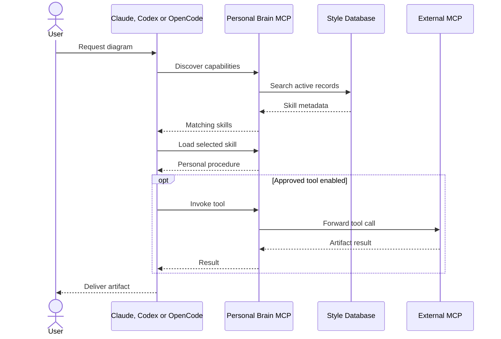

# Architecture — Personal Brain Style Studio

Current implementation design: [HLD](architecture/hld-personal-brain-style.md), [application-core LLD](design/lld-personal-brain-core.md), and [verification report](architecture/design-verification.md). These source-verified drafts expand this overview and identify current limitations.

## Scope

This is a **personal working style product**. It is not a codebase index, project-memory engine, repository analysis tool, or LLM runtime.

- **Persistent:** global preferences, skills, examples, tool catalog, review criteria and feedback.
- **Versioned:** every edit is stored as a snapshot revision. Restores create new revisions.
- **Portable:** Claude Code, Codex CLI and OpenCode access the same MCP server using native stdio connections. ChatGPT gets a read-only, project-pinned mode through the OpenAI Secure MCP Tunnel; Claude Desktop has its own MCP entry.
- **Discoverable:** compact task-based search returns metadata, then specific instructions are loaded on demand.
- **Local-first:** SQLite WAL and a web UI bound to loopback.

## Component boundaries

```text
 Claude Code CLI   Codex CLI   OpenCode (plugin)
       |               |             |
       +---------------+-------------+
                | MCP stdio
      +---------v----------+
      | Personal Brain MCP |
      | Bootstrap/Discover |
      | Get/Review/Feedback|
      +---------+----------+
                |
      +---------v----------+         +------------------+
      | Style Repository   | <-----> | Web UI / HTTP API|
      | SQLite + Revisions |         | 127.0.0.1:4177   |
      +---------+----------+         +------------------+
                |
      +---------v----------+
      | Optional Tool Proxy| --opt-in--> External MCP tools
      +--------------------+
```

## Session flow



## Data model

| Table | Purpose |
|---|---|
| `records` | Current state of style, skill, example (shown as Templates), review, and tool entries |
| `domains` | Capabilities, with a `combinable` flag |
| `projects` | Project selections, overrides and version |
| `revisions` | Immutable-by-API snapshots per record version |
| `feedback` | User corrections, approvals, rejections to review |
| `audit` | Creation, modification, restore, feedback operations |
| `meta` | Internal metadata including the keyed prompt-trace HMAC secret |
| `trace_events` | Privacy-minimized hook and MCP call evidence, record IDs, versions, and demo marker |

Each record has an ID, kind, domain, title, summary, body, search tags, priority, status, version, timestamps, optional deterministic checks, optional required links (`requiredIds`, up to 12 record IDs, no cycles), and optional external MCP backend configuration. The UI labels kind `example` as **Templates**; the stored kind and API value stay `example`.

### Selection rules

A project selects styles per capability (domain). In a **combinable** capability a project may select several styles of the same kind; in a **Pick one** capability it may select one style of each kind. All nine release-catalog capabilities are combinable. Switching a capability to Pick one is refused while any project selects two styles in it. Required styles load transitively; format styles (Draw.io, Mermaid) are selected per project, never required.

### Revision contract

- Create generates v1.
- Update requires `expectedVersion`, creates v(n+1), transaction committed atomically.
- Restore targets an older version and creates a **new** current version, without deleting history.
- Concurrent stale updates fail with HTTP 409.

## MCP design

Tools exposed:
- `brain_bootstrap`: small baseline profile.
- `brain_discover`: task-based discovery of relevant skills/preferences/tools.
- `brain_get`: read a selected active entry.
- `brain_style`: read preferences for a domain.
- `brain_review`: run deterministic text checks.
- `brain_feedback`: record pending feedback for human approval.
- `brain_inspect_tool`: list tool names and JSON schemas from an explicitly enabled external MCP server.
- `brain_call_tool`: optionally invoke an approved external MCP server and a specific tool.

Resource: `brain://style/baseline`. Prompt: `personalized_task`.

Implementation note: this release uses a dependency-free MCP stdio JSON-RPC implementation (initialize, tools, resources, prompts and ping). It is interoperable with common stdio MCP clients, but does not implement the entire MCP specification. Replacing it with the official `@modelcontextprotocol/server` v2 SDK is the recommended next hardening task.

## Security model

The browser API requires no login or access token. The UI listens only on 127.0.0.1. Its SQLite file is created with owner-only permissions where supported. Tool invocation is **disabled by default**, requires an enabled backend, and requires `PB_ENABLE_TOOL_PROXY=1` in the MCP process. No shell is used for backend command execution.

**Limitations:** Any program running with the same macOS user permissions can access local data or modify CLI configuration. MCP access itself is authenticated by the client's local ability to start the process, not a separate identity scheme. Admin-defined tool commands are privileged and should be treated like running trusted software. The application does not sandbox an external tool, filter sensitive inherited environment variables, or proxy arbitrary third-party MCP servers automatically.

## Excluded by design

- Project-scoped knowledge or project indexing.
- Sharing project documents or facts across contexts.
- Agent orchestration or additional model loops.
- Automatic model fine-tuning.
- Fully automated style mutation without human approval.
- Visual geometry validation of draw.io or Excalidraw artifacts.

## Automatic activation integration (v1.1)

Personal Brain uses the built-in lifecycle hook APIs of Claude Code and Codex CLI, and a plugin for OpenCode. These are not additional agent harnesses.

- `SessionStart`: invokes `src/cli.ts hook <agent> session`. Reads SQLite preference baseline and injects a short shared policy. Uses JSON `hookSpecificOutput.additionalContext`.
- `UserPromptSubmit`: invokes `src/cli.ts hook <agent> prompt`. Reads the submitted task from hook stdin, classifies its intent, ranks active knowledge records and injects only the relevant skills and preferences.
- `personal-brain connect claude|codex|opencode|all` installs the hooks (or the OpenCode plugin) and registers the MCP server through the agent's own CLI (`claude mcp add …`, `codex mcp add …`; an existing entry is removed first). `disconnect` removes both. If the agent CLI is not on PATH, the command to run is printed. `hooks install|remove|status` manages only hooks or the plugin.
- OpenCode: one managed file, `~/.config/opencode/plugins/personal-brain.js`. Its `config` hook registers the MCP server (`opencode.json` is not edited), `chat.message` runs the session and prompt hooks, and `experimental.chat.system.transform` injects their context. It refuses to overwrite a file it did not create.
- Install type decides how agents launch Personal Brain (`src/agents/launcher.ts`): a global install uses `personal-brain`; an npx copy uses `npx --yes personal-brain-style@<version>`, pinned so a cleared npx cache does not break registrations; a source checkout uses absolute paths. The UI always shows `personal-brain …` and offers the install, npx and absolute forms when that command is not on PATH.
- The web UI **Agent setup** page shows one card per agent with its install status, copy buttons and undo command. Status means the hook or plugin file is installed; it does not assert that a running agent has loaded or trusted it.
- Hook installation merges into existing settings and removal preserves unrelated hooks or configuration.

The product supplies instructions, **not another user message**, and does not automatically start token-consuming agent turns. No project-specific knowledge is stored. Existing Claude and Codex user interaction permissions remain unchanged.

For security, hook commands run as the local user. Review code and backups before installation. Codex requires explicit hook trust using `/hooks`. Hook context is advisory; enforce sensitive operations with real authorization mechanisms and filesystem permissions, not a style preference.

## Trace Explorer extension (v1.2)

The trace writer is independent of the agent runtime. It records observable facts from each supported entry point:

- `src/agents/hooks.ts` records startup and prompt hook output, exactly matched records and their versions, and a keyed digest of the submitted prompt. A hook trace records context **emitted**, not confirmed model consumption.
- `src/agents/mcp.ts` records handshake, tool listing, and tool invocations. It records skill IDs and versions returned by `brain_discover`, `brain_get`, `brain_style` and `brain_bootstrap` and status for `brain_review`.
- `src/core/database.ts` owns a shared append-only trace table and a separate demonstration flag. Real usage statistics exclude demo records.
- `src/server/http.ts` exposes trace query endpoints, plus synthetic-example endpoints kept for development; the UI no longer offers sample traces.
- `web/app.ts` provides a live-updating timeline and reverse-trace lookup by record, agent (including `opencode` and `chatgpt`) and channel, including recorded versions and evidence limitations.

Hooks and MCP connections are often separate processes. Their run IDs must not be treated as one shared distributed trace unless the host provides a common correlation identifier; Personal Brain does not invent one. There is no prompt/response capture, no monitoring of model reasoning, and no automatic conclusion about instruction effectiveness.

Read [TRACE.md](TRACE.md) for the privacy model and interpretation guide.

## Example: select, discover and verify a catalog style

1. In **Configure project**, select **Drawing — clear architecture, flows and data models** and the format style **Draw.io — editable architecture, flow and ER diagrams**. Drawing is combinable, so both stay selected. Required styles are added transitively; saving validates them.
2. Ask a connected agent: "Draw an editable architecture diagram of this service." The prompt hook (or OpenCode plugin) emits matching record IDs. For explicit discovery the agent calls `brain_discover` with the task and `projectId`, then `brain_prepare` or `brain_get` to load the full records and required links.
3. The agent follows the style's METHOD and DELIVERABLES, uses listed skills only when installed, and reports any it lacks.
4. Before completion it calls `brain_review` with the prepared `instructionSetId` and evidence per requirement. Visual and editability checks remain the agent's or reviewer's job.
5. Trace Explorer shows which record versions were emitted or retrieved. Inspect the artifact itself before accepting it.

The full catalog is listed in [STYLE-CATALOG.md](STYLE-CATALOG.md). [MY-STYLE.md](MY-STYLE.md) describes the older sample recipes.
