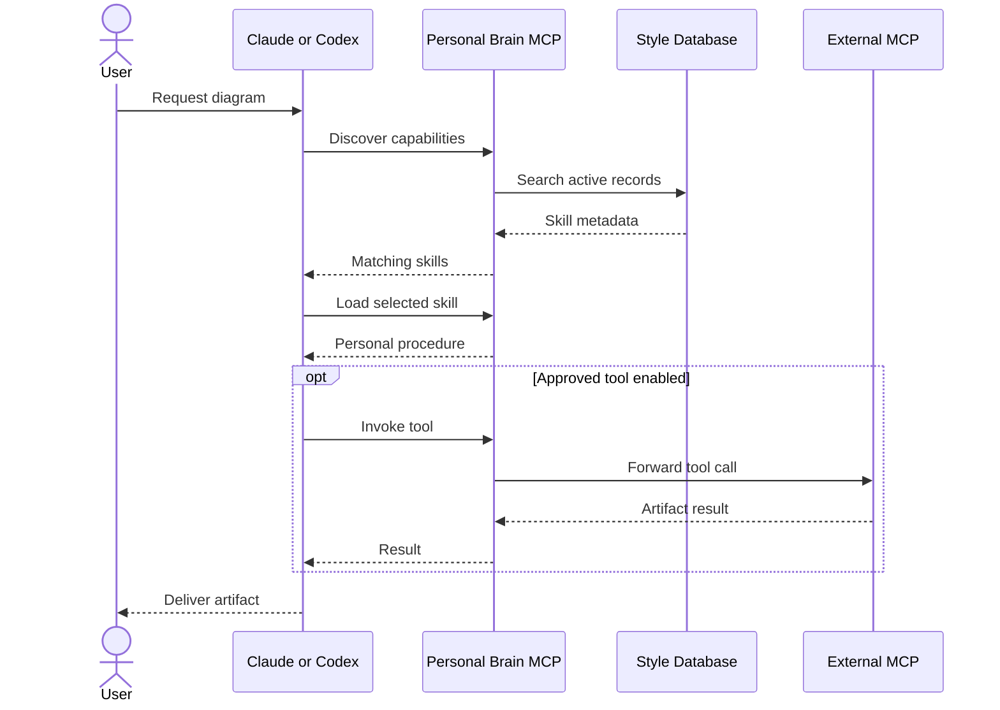

# Architecture — Personal Brain Style Studio

## Scope

This is a **personal working style product**. It is not a codebase index, project-memory engine, repository analysis tool, or LLM runtime.

- **Persistent:** global preferences, skills, examples, tool catalog, review criteria and feedback.
- **Versioned:** every edit is stored as a snapshot revision. Restores create new revisions.
- **Portable:** Claude Code and Codex access the same MCP server using native stdio connections.
- **Discoverable:** compact task-based search returns metadata, then specific instructions are loaded on demand.
- **Local-first:** SQLite WAL and a web UI bound to loopback.

## Component boundaries

```text
 Claude Code CLI      Codex CLI
       |                  |
       +--------+---------+
                | MCP stdio
      +---------v----------+
      | Personal Brain MCP |
      | Bootstrap/Discover |
      | Get/Review/Feedback|
      +---------+----------+
                |
      +---------v----------+         +------------------+
      | Style Repository   | <-----> | Web UI / HTTP API|
      | SQLite + Revisions |         | 127.0.0.1:4177   |
      +---------+----------+         +------------------+
                |
      +---------v----------+
      | Optional Tool Proxy| --opt-in--> External MCP tools
      +--------------------+
```

## Session flow



## Data model

| Table | Purpose |
|---|---|
| `records` | Current state of style, skill, example, review, and tool entries |
| `revisions` | Immutable-by-API snapshots per record version |
| `feedback` | User corrections, approvals, rejections to review |
| `audit` | Creation, modification, restore, feedback operations |
| `meta` | Internal metadata including the keyed prompt-trace HMAC secret |
| `trace_events` | Privacy-minimized hook and MCP call evidence, record IDs, versions, and demo marker |

Each record has an ID, kind, domain, title, summary, body, search tags, priority, status, version, timestamps, optional deterministic checks, and optional external MCP backend configuration.

### Revision contract

- Create generates v1.
- Update requires `expectedVersion`, creates v(n+1), transaction committed atomically.
- Restore targets an older version and creates a **new** current version, without deleting history.
- Concurrent stale updates fail with HTTP 409.

## MCP design

Tools exposed:
- `brain_bootstrap`: small baseline profile.
- `brain_discover`: task-based discovery of relevant skills/preferences/tools.
- `brain_get`: read a selected active entry.
- `brain_style`: read preferences for a domain.
- `brain_review`: run deterministic text checks.
- `brain_feedback`: record pending feedback for human approval.
- `brain_inspect_tool`: list tool names and JSON schemas from an explicitly enabled external MCP server.
- `brain_call_tool`: optionally invoke an approved external MCP server and a specific tool.

Resource: `brain://style/baseline`. Prompt: `personalized_task`.

Implementation note: this release uses a dependency-free MCP stdio JSON-RPC implementation (initialize, tools, resources, prompts and ping). It is interoperable with common stdio MCP clients, but does not implement the entire MCP specification. Replacing it with the official `@modelcontextprotocol/server` v2 SDK is the recommended next hardening task.

## Security model

The browser API requires no login or access token. The UI listens only on 127.0.0.1. Its SQLite file is created with owner-only permissions where supported. Tool invocation is **disabled by default**, requires an enabled backend, and requires `PB_ENABLE_TOOL_PROXY=1` in the MCP process. No shell is used for backend command execution.

**Limitations:** Any program running with the same macOS user permissions can access local data or modify CLI configuration. MCP access itself is authenticated by the client's local ability to start the process, not a separate identity scheme. Admin-defined tool commands are privileged and should be treated like running trusted software. The application does not sandbox an external tool, filter sensitive inherited environment variables, or proxy arbitrary third-party MCP servers automatically.

## Excluded by design

- Project-scoped knowledge or project indexing.
- Sharing project documents or facts across contexts.
- Agent orchestration or additional model loops.
- Automatic model fine-tuning.
- Fully automated style mutation without human approval.
- Visual geometry validation of draw.io or Excalidraw artifacts.

## Automatic activation integration (v1.1)

Personal Brain uses the built-in lifecycle hook APIs of both Claude Code and Codex CLI. These are not additional agent harnesses.

- `SessionStart`: invokes `src/cli.ts hook <agent> session`. Reads SQLite preference baseline and injects a short shared policy. Uses JSON `hookSpecificOutput.additionalContext`.
- `UserPromptSubmit`: invokes `src/cli.ts hook <agent> prompt`. Reads the submitted task from hook stdin, classifies its intent, ranks active knowledge records and injects only the relevant skills and preferences.
- Normal MCP server: separately registered using the existing `connect-macos.sh` script; deeper discovery is optional on demand.
- The web UI `Auto Activation` tab shows which hook definitions are installed. It does not assert that a running agent has loaded or trusted the hooks.
- Installer: `scripts/activate-personal-brain.sh --apply` merges hooks and backs up changed settings. Removal preserves any unrelated hooks or configuration.

The product supplies instructions, **not another user message**, and does not automatically start token-consuming agent turns. No project-specific knowledge is stored. Existing Claude and Codex user interaction permissions remain unchanged.

For security, hook commands run as the local user. Review code and backups before installation. Codex requires explicit hook trust using `/hooks`. Hook context is advisory; enforce sensitive operations with real authorization mechanisms and filesystem permissions, not a style preference.

## Trace Explorer extension (v1.2)

The trace writer is independent of the agent runtime. It records observable facts from each supported entry point:

- `src/agents/hooks.ts` records startup and prompt hook output, exactly matched records and their versions, and a keyed digest of the submitted prompt. A hook trace records context **emitted**, not confirmed model consumption.
- `src/agents/mcp.ts` records handshake, tool listing, and tool invocations. It records skill IDs and versions returned by `brain_discover`, `brain_get`, `brain_style` and `brain_bootstrap` and status for `brain_review`.
- `src/core/database.ts` owns a shared append-only trace table and a separate demonstration flag. Real usage statistics exclude demo records.
- `src/server/http.ts` exposes authenticated trace query and synthetic-example endpoints to the UI.
- `web/app.ts` provides a reverse-trace lookup by preference/skill record, agent and channel, including recorded versions and evidence limitations.

Hooks and MCP connections are often separate processes. Their run IDs must not be treated as one shared distributed trace unless the host provides a common correlation identifier; Personal Brain does not invent one. There is no prompt/response capture, no monitoring of model reasoning, and no automatic conclusion about instruction effectiveness.

Read [TRACE.md](TRACE.md) for the privacy model and interpretation guide.

## Complete example: edit, discover and verify a style

The sky blue UI calls the same authenticated API; My Styles is the display name for existing `preference` records. No schema or MCP naming change is required.

1. Start the updated server. Server initialization imports the full missing sample library and clearly marked demo traces before accepting requests. The browser also posts to `/api/styles/seed` on connection; repeated imports preserve existing edits. Eleven new recipes start as drafts.
2. Expand “Sky blue architecture drawing” to read its instructions, example prompt and worked topology. Edit it, customize it and save as Active. The browser sends a new record, or a PUT with `expectedVersion` for an existing recipe.
3. The API checks origin and record input. BrainDB commits the record and revision together. A stale edit returns 409, with unsaved content retained in the editor.
4. Ask an agent: “Draw an editable architecture diagram with sky blue groups and explicit trust boundaries.” An installed prompt hook can emit matching active instructions. For explicit discovery use `brain_discover` with that task, then `brain_get` with the returned recipe ID. Drafts are excluded.
5. A complete topology has Browser → loopback HTTP API → BrainDB → SQLite WAL; Claude/Codex → hooks or MCP stdio → BrainDB; and an optional gated proxy → configured external MCP tool. Label interfaces and show the external process trust boundary.
6. Produce the editable diagram using available tooling. Check syntax and visually inspect its rendering when supported. Record any missing verification. Style instructions alone do not install or enable drawing tools.
7. Trace Explorer can show the recipe ID and version emitted or retrieved. Independently inspect the artifact before accepting it. History can restore an earlier rule as a new revision.

The eleven recipes and their complete worked outputs are in [MY-STYLE.md](MY-STYLE.md). Technology comparisons there illustrate a decision method; they are not current vendor research.
