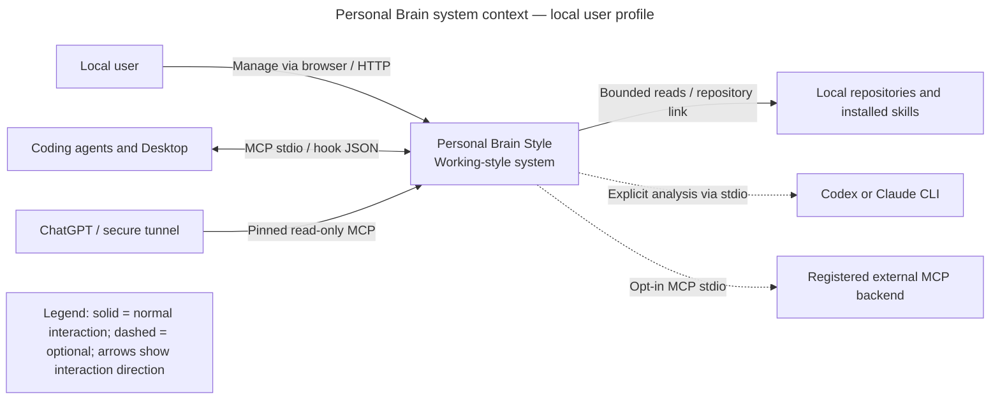
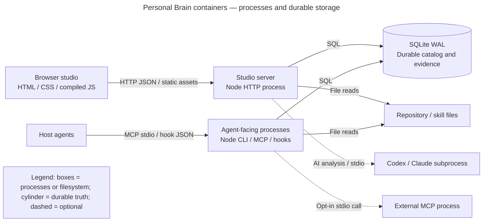
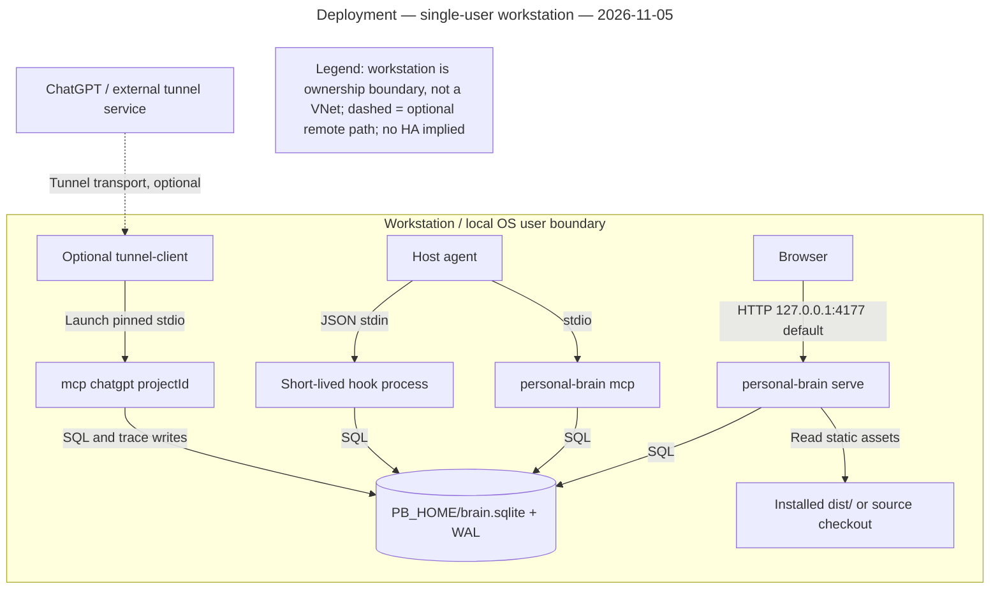

# HLD: Personal Brain Style

Personal Brain Style is a local-first working-style repository shared by a browser studio and coding-agent integrations. This current-state design explains its process boundaries, durable data, safeguards and limitations for maintainers, architects and operators. The system delivers instructions and bounded evidence; it does not enforce model compliance.

| Document control | Value |
|---|---|
| Status | Draft — current-state documentation, not architectural approval |
| Version | 0.1 |
| Implementation baseline | Git `5afdc6a` plus the working-tree `1.3.0-beta.3` release metadata and package-test correction |
| Evidence date | 2026-11-05 |
| Owner / approver | Not assigned; repository maintainer to nominate |
| Requirements | Derived capability references CAP-01–CAP-08 below; no approved BRD baseline supplied |
| ADRs | No formal ADR files found in the repository file inventory |
| Companion | [Application-core LLD](../design/lld-personal-brain-core.md) |
| Verification | [Evidence and validation report](design-verification.md) |

## 1. Introduction and goals

A user curates preferences, skills, examples, review rules and registered tools once, then selects and adapts them per project. Hosts receive a compact index before retrieving complete instructions on demand. Project selections contain working-style configuration, not a project-memory corpus. Bounded repository reads support explicit analysis; they do not build a repository index.

These IDs are documentation references derived from code, not newly approved business requirements:

| ID | Implemented capability | Primary evidence |
|---|---|---|
| CAP-01 | Store, revise and restore style records | [BrainDB](../../src/core/database.ts) |
| CAP-02 | Resolve project selections, overrides and private copies | [BrainDB](../../src/core/database.ts), [project scope](../../src/projects/project-scope.ts) |
| CAP-03 | Deliver compact hooks and scoped MCP discovery/retrieval | [hooks](../../src/agents/hooks.ts), [MCP](../../src/agents/mcp.ts) |
| CAP-04 | Bind task instructions to versions and record bounded artifact review | [instruction sets](../../src/instructions/instruction-set.ts), [review](../../src/instructions/artifact-review.ts) |
| CAP-05 | Link repositories and discover evidence and installed skills | [onboarding](../../src/projects/onboarding.ts), [skill discovery](../../src/projects/skill-discovery.ts) |
| CAP-06 | Propose and explicitly apply reusable style improvements | [Fusion](../../src/instructions/fusion.ts) |
| CAP-07 | Inspect invocation evidence without ordinary prompt capture | [trace storage](../../src/core/database.ts), [trace guide](../TRACE.md) |
| CAP-08 | Distribute a compiled npm package and connect supported hosts | [package manifest](../../package.json), [launcher](../../src/agents/launcher.ts), [package build](../../scripts/build-package.mjs) |

Quality priorities are preservation of user edits, project isolation, small initial context, explicit uncertainty in review, and reproducible installation. Numeric availability, throughput, latency, RPO and RTO commitments have not been set.

Stakeholders are the local user (style decisions), repository maintainers (implementation and releases), host-agent users (instruction consumers), and reviewers (artifact acceptance). These are roles, not assigned people.

## 2. Constraints

- The shipped application uses Node built-ins, including `node:sqlite`; YAML frontmatter uses the bundled `yaml` runtime dependency. TypeScript is a development dependency. The [runtime gate](../../scripts/runtime-compat.mjs) permits Node 22.13+, Node 23.6+, and Node 24 or newer; Node 18 is rejected.
- The supported browser-server binding is `127.0.0.1`, port 4177 by default. It is a single-user local tool, not a hosted multi-tenant service.
- Agent integrations rely on installed host CLIs/configuration and their permissions. An installed hook is not proof that a host trusted or executed it.
- SQLite calls and much filesystem work are synchronous. Separate HTTP, MCP and hook processes may open the same database; WAL and a 5-second busy timeout coordinate access.
- Optional AI analysis uses the user's Codex or Claude CLI session. The application does not supply a model runtime, credentials service or scheduler.
- No selected HLD record was returned by project-scoped discovery during this work. The HLD outline follows the bundled `doc-hld` template in the [catalog](../../src/styles/global-style-catalog.ts); project activation is not asserted.

## 3. Context and scope

[Editable context view](diagrams/context.mmd) shows people and external systems. Its C4 semantics are expressed with Mermaid flowchart notation; internal modules are intentionally excluded.

| External actor/system | Interface | Purpose and boundary |
|---|---|---|
| Local user | Browser HTTP on loopback | Manage styles, projects, history, Fusion and diagnostics |
| Claude Code, Codex, OpenCode | MCP JSON-RPC over stdio; hook JSON | Retrieve scoped instructions; hooks emit advisory context |
| Claude Desktop | Configured local stdio MCP process | Desktop access to the same catalog |
| ChatGPT through tunnel client | Project-pinned MCP stdio behind external tunnel | Four read-only tools; no local skill-file access through this mode |
| Codex/Claude analysis subprocess | JSON input/output through local CLI | User-triggered onboarding suggestions and Fusion proposals |
| Registered MCP backend | Child-process stdio | Optional, explicitly enabled tool invocation |
| Local repositories and skill folders | Bounded filesystem reads | Evidence, repository link and installed-skill inventory |
| npm | Package distribution | Install compiled application; no registry needed for ordinary local catalog reads |

In scope: the current application and its packaging, adapters, data and explicit analysis workflows. Out of scope: host-agent internals, cloud infrastructure design, model training, a repository knowledge graph, general-purpose agent orchestration, public HTTP hosting, and independent certification of generated artifacts.

## 4. Solution strategy

| Observed choice | Driver | Consequence |
|---|---|---|
| Shared TypeScript core used by several process modes | CAP-01–04, CAP-08 | Reuse policy and persistence; no separate internal service API |
| SQLite snapshots plus revision rows | CAP-01 | Simple local deployment and restore-to-new-version; database backup remains an operator responsibility |
| Metadata discovery followed by explicit full retrieval | CAP-03 | Reduces routine context, but matching remains lexical and may omit relevant records |
| Copy shared styles when personalising a project | CAP-02 | Preserves global/other-project content; dependent ancestors may also need private copies |
| Version/digest checks before review and Fusion application | CAP-04, CAP-06 | Rejects stale state; cannot prove the chosen style scope was complete |
| Human/agent-selected proposal application | CAP-06 | Analysis results do not silently mutate shared styles |
| Compiled npm distribution | CAP-08 | Installed entry paths target JavaScript; package smoke tests check that contract |

These are observations from the implementation, not retrospective ADR approvals. No new platform or architectural migration is proposed by this documentation.

## 5. Container view

[Editable container view](diagrams/containers.mmd) separates executable/storage boundaries. `src/core`, `src/projects` and `src/instructions` are in-process modules, not independently deployed services.

| Container | Responsibility | Technology | Operational owner |
|---|---|---|---|
| Browser studio | Local interaction and diagnostics | `web/app.ts` compiled to browser JS; static HTML/CSS | Local user; maintenance role unassigned |
| Studio server process | Serve static assets, HTTP API, explicit AI jobs | Node HTTP, `src/server/http.ts` | Local user |
| Agent-facing processes | MCP sessions and short-lived hooks/CLI operations | Node stdio, `src/agents`, `src/cli.ts` | Host agent / local user |
| Style database | Durable truth for records, projects, revisions and trace metadata | SQLite WAL, `brain.sqlite` | Local user |
| Optional analysis process | Produce proposals; no direct style writes | Installed Codex or Claude CLI | Local user / host provider |

The database is a shared file, not a network database container. External skill files and repository content remain filesystem inputs; they are not copied into a project-memory store by discovery.

## 6. Key flows

1. **Instruction delivery:** [retrieve sequence](diagrams/retrieve.mmd). The host resolves project scope, discovers metadata, loads selected records/dependencies, and optionally loads an installed skill. Invalid scope or unavailable selections return errors.
2. **Project personalisation:** [personalise sequence](diagrams/personalize.mmd). A version-checked update copies a shared record and affected ancestors, rewires selections and commits atomically. Other projects retain their shared versions.
3. **Prepare and review:** [prepare sequence](diagrams/prepare.mmd) and [review sequence](diagrams/review.mmd). The agent chooses roots; preparation fingerprints effective instructions. Review rejects drift, verifies bounded artifact presence and records manual uncertainty.
4. **Fusion:** [Fusion sequence](diagrams/fusion.mmd). A user starts analysis, reviews proposals, then applies or rejects each. Application rechecks source/target versions and unresolved conflicts before changing shared records.

The [LLD](../design/lld-personal-brain-core.md) additionally describes hooks, record edits/restores, onboarding, removal and the optional tool bridge.

## 7. Deployment view

[Editable deployment view](diagrams/deployment.mmd): single-user workstation profile, evidence dated 2026-11-05. There is no proven multi-node or production-HA topology.

| Profile | Entry | Assets/data | Network |
|---|---|---|---|
| Source development | `npm start` via `scripts/dev.mjs` | TypeScript sources; generated browser JS; user-selected PB_HOME | Loopback UI; development reload |
| Source stable | `npm run start:stable` | Source CLI via compatibility runner | Loopback UI |
| npm install | `personal-brain serve` | `dist/` JS/static files; database outside package | Loopback UI; package download at installation |
| Host integration | `personal-brain mcp` or hook CLI | Per-session process shares local SQLite | stdio, no application listener required |
| Optional ChatGPT | `personal-brain chatgpt-connect <projectId>` | Tunnel client launches pinned MCP mode | External tunnel connectivity; UI remains loopback |

The default data location is `~/.personal-brain-style/brain.sqlite`; `PB_HOME` selects another directory. Hook/config installation and repository links are separate from npm package files. The package archive excludes the live database. The current package allowlist does not ship these new design documents; they live in the repository.

## 8. Cross-cutting concepts

**Security.** HTTP has no login/token requirement. When an Origin is supplied, API requests require exact HTTP loopback origin/Host agreement; absent Origin is accepted. CSP, frame denial and no-sniff headers protect the browser surface. These controls do not isolate processes running as the same OS user. Project selection is application-level scoping, not multi-user authorisation. Database creation requests owner-only permissions where supported. See [HTTP source](../../src/server/http.ts) and [database source](../../src/core/database.ts).

**Remote access.** ChatGPT mode exposes only bootstrap/discover/get/style, refuses scope changes and does not load installed local skill files. It still creates invocation telemetry; read-only means no style-management tools, not zero disk writes. Tunnel credentials remain in process environment in the [helper](../../scripts/connect-chatgpt.sh).

**External execution.** The MCP bridge requires both an enabled backend and `PB_ENABLE_TOOL_PROXY=1`. It uses `shell:false`, timeout and response-buffer limits, but inherits the environment and is not a sandbox. Onboarding/Fusion explicitly launch model CLIs with tool restrictions; source evidence may contain sensitive text despite path exclusions. Those workflows can send input to the configured host provider.

**Data and consistency.** Record writes pair current snapshots, revisions and audit rows within SQLite savepoints. Project edits use record and project version checks. Restoring a revision creates a new current version. Explicit removal can delete historical revisions and traces; revisions are not an immutable external audit ledger.

**Observability.** Trace events show emitted/retrieved instructions and record versions. Ordinary telemetry stores whitelisted metadata and keyed prompt fingerprints, not prompts or responses. Explicit compliance reports and Fusion snapshots have additional content; do not describe the entire database as metadata-only. Separate hook and MCP processes may lack a common session ID.

**Resilience.** Atomic local updates and backup support exist; no automated off-device backup, replication, retention policy, operational SLO or tested disaster recovery guarantee is established. Failed Fusion jobs do not automatically retry.

## 9. Decisions

No formal ADR index was found. The following evidence index records existing choices without asserting approval:

| Reference | Choice | Evidence |
|---|---|---|
| OBS-01 | Local SQLite WAL | [BrainDB constructor](../../src/core/database.ts) |
| OBS-02 | Native stdio MCP and compact hooks | [MCP](../../src/agents/mcp.ts), [hooks](../../src/agents/hooks.ts) |
| OBS-03 | Private copies and optimistic versions | [personalizeRecord](../../src/core/database.ts) |
| OBS-04 | Explicit proposal review/application | [Fusion](../../src/instructions/fusion.ts) |
| OBS-05 | Manual checks remain unverified | [artifact review](../../src/instructions/artifact-review.ts) |

A future change to process boundaries, storage, security model or remote access should introduce a formal decision record. This document does not authorise such a change.

## 10. Quality scenarios

| Scenario | Observable measure | Evidence/test | Status |
|---|---|---|---|
| Two edits use the same version | Later stale edit is rejected; prior state retained | `tests/database.test.ts`, `tests/projects.test.ts` | Existing automated coverage |
| One project personalises a shared dependency | Global and other-project values unchanged | `tests/private-styles.test.ts` | Existing automated coverage |
| Instructions change after preparation | Review rejects stale set | `tests/instruction-set.test.ts` | Existing automated coverage |
| Artifact path escapes linked root | Review rejects traversal/symlink escape | `tests/artifact-review.test.ts` | Existing automated coverage |
| Hook emits context | Metadata index stays bounded; full bodies loaded separately | `tests/hooks.test.ts` | Existing automated coverage |
| Installed package starts without source checkout | CLI/MCP/hooks/assets resolve compiled paths | `scripts/test-package.mjs` | Existing smoke test |
| Workstation/database lost | Restore a consistent backup on another installation | Manual recovery drill | Not verified; no RPO/RTO agreed |
| Catalog grows or concurrent load rises | Latency, lock contention and scan limits measured | Benchmark needed | Not verified; no performance target agreed |

Current execution results and exact commands are in the verification report. A test file establishes intended coverage, not an operational service guarantee.

## 11. Risks and technical debt

| Risk | Impact | Mitigation/current boundary | Owner |
|---|---|---|---|
| Local HTTP treated as a public service | Unauthenticated mutation exposure | Keep supported loopback binding | Operator role; person unassigned |
| Stale/bounded discovery misses a relevant style | Incomplete instructions | Explicit full retrieval and review; inspect selection | Agent/user |
| AI-generated proposal contains bad guidance | Shared future behaviour changes | Validate structure, review rationale/conflicts, explicit apply | Style owner |
| Trace read as proof of compliance | False acceptance | Preserve emitted/retrieved/manual distinctions | Reviewer |
| Broad JSON-snapshot DB and synchronous work | Contention/maintenance cost | Preserve tests; measure before scaling | Maintainer role |
| No tested recovery/retention policy | Data loss or accumulated sensitive content | Consistent backup and operator policy needed | Operator role |
| MCP lifecycle compatibility | Only legacy 2025-11-25 is implemented | Initialization now reports package version and supported protocol; newer lifecycle remains unverified | Maintainer role |

## 12. Glossary

| Term | Meaning |
|---|---|
| Style record | Preference, skill, example, review or registered tool entry |
| Capability/domain | Category controlling grouping and selection combinations |
| Effective record | Selected record with project override and required dependency context |
| Private copy | Project-owned record preserving a shared source link |
| Instruction set | Stored task/project/version fingerprint, not a compliance certificate |
| Fusion | User-triggered consolidation proposals for existing shared styles |
| MCP | Model Context Protocol; this implementation uses newline-delimited stdio JSON-RPC |
| WAL | SQLite write-ahead logging |
| HLD / LLD / ADR | High-level design / low-level design / architecture decision record |

## Appendix: Change log

| Version | Date | Author | Change |
|---|---|---|---|
| 0.1 | 2026-11-05 | Codex, pending maintainer review | Current-state HLD with source-linked views and explicit limitations |
