# LLD: Personal Brain application core

The Personal Brain application core resolves effective working styles, persists versioned changes, and delivers them through HTTP, MCP and hooks. This current-state LLD gives maintainers the contracts, state, persistence and failure behaviour needed to change that core safely. It describes observed implementation, not a proposed rewrite.

| Metadata | Value |
|---|---|
| Status / version | Draft / 0.1 |
| Evidence date | 2026-11-05 |
| Baseline | `5afdc6a` plus working-tree `1.3.0-beta.3` release metadata and package-test correction |
| Parent HLD | [Personal Brain HLD](../architecture/hld-personal-brain-style.md) |
| Parent containers | Studio server and agent-facing Node processes; shared SQLite store |
| Requirements | HLD-derived CAP-01–CAP-08; no signed BRD or formal ADR baseline supplied |
| Owner / approver | Not assigned; maintainer nomination and review pending |
| Verification | [Design evidence report](../architecture/design-verification.md) |

## 1. Context

The component is the shared application core used by both Node process modes, with its transport adapters. Browser event handlers and external host-agent internals are outside its detailed scope. Public API families are mapped below; exact field schemas remain authoritative in [MCP tools](../../src/agents/mcp.ts), [HTTP handlers](../../src/server/http.ts) and [models](../../src/core/models.ts).

The existing graph indexes pre-reorganisation paths such as `src/mcp.ts`; coverage reports do not establish current source freshness. This design uses direct reads of current `src/agents`, `src/core`, `src/projects`, `src/instructions` and `src/server` files. Links intentionally target files rather than unstable line ranges.

## 2. Responsibilities and non-responsibilities

The core owns record validation, versioned persistence, project selection/closure, scoped discovery, revision restore, instruction-set fingerprints, bounded review evidence, trace metadata, and explicit proposal application. It also coordinates repository linking and optional analysis processes.

It does not own model reasoning, the correctness of a generated document, independent manual-review approval, a shared identity service, cloud hosting, repository indexing, or the contents/implementation of external skills. The web studio presents these functions; it is not a second source of durable truth.

## 3. Interfaces

### Operation contracts

IDs below are local documentation identifiers. Every operation has a sequence reference in section 5 and an existing test mapping in section 11, or an explicit coverage gap.

| ID | Entry and input | Output / postcondition | Rejection or failure |
|---|---|---|---|
| OP-01 | `create(raw)`, `update(id, raw, expectedVersion)`, `restore(id, targetVersion, expectedVersion)` | Valid record, current snapshot, new revision and audit row | Invalid schema/dependency 400; missing record/revision 404; stale version 409 |
| OP-02 | `personalizeRecord(projectId, recordId, changes, expectedVersion, expectedProjectVersion)` | Private effective record; copied ancestors where needed; project version increment | Wrong scope, changed kind/domain/status, invalid links or stale versions; transaction rolled back |
| OP-03 | `brain_discover(task, projectId)` then `brain_get(id, projectId)`; optional installed-skill load | Metadata shortlist, full scoped dependency closure/checklist, separately loaded skill text | Invalid task/project, unavailable record, missing skill, bounded-read errors |
| OP-04 | `brain_prepare(projectId, task, recordIds)` | Stored set ID, project version, full effective records and checklist | Task outside 1–1000 chars; roots not 1–20 unique selected IDs; over 300 requirements |
| OP-05 | `brain_review(projectId, instructionSetId, artifacts, evidence, content?)` | Persisted report with `pass`, `fail` or `not_verified` and review ID | Stale scope/digest, duplicate/stale evidence, unsafe paths or excessive limits |
| OP-06 | `startFusion({agent, projectIds})`; later `applyFusion`, `rejectFusion`, `cancelFusion` | Persisted job/proposals; apply creates a shared record revision | Bad inputs, busy process, failed CLI, invalid proposals, conflicting guidance, changed source/target |
| OP-07 | `createLinkedProject(db, project, folder)` | Project plus `.personal-brain.json` link and repository metadata | Invalid/already-linked folder or invalid closure; rollback and link compensation |
| OP-08 | `executeHook(db, agent, phase)` with stdin JSON | Event-specific `additionalContext`, or empty output | Malformed input treated as empty; processing errors log to stderr and skip context |
| OP-09 | `brain_call_tool(id, arguments)` / `brain_inspect_tool(id)` | External MCP result or schemas | Missing/inactive tool, disabled backend/proxy, process failure, timeout, oversized response |
| OP-10 | `deletionPreview(kind,id)` then `deleteWithPreview(kind,id,fingerprint)` | Confirmed removal/reset plus survivor rewiring | Unsupported type, absent target, stale fingerprint; rollback on failure |

HTTP JSON success uses route-specific 200/201/202 status. Errors are `{error, message}` with `BrainError.status` or 500; invalid-origin and some not-found responses have smaller error bodies. MCP tools return text content containing JSON or text, with `isError:true` for tool failures. JSON-RPC parse/method failures use the protocol error object. A tool-level error is not an HTTP status response.

### Transport surface

| Surface | Families and important behaviour |
|---|---|
| HTTP catalog | `/api/items`, item/history/restore, `/api/domains`, `/api/summary`, seed routes |
| HTTP projects | `/api/projects`, resolved/activity/repository/discovery, project item personalisation/publish |
| HTTP workflows | `/api/onboarding/*`, `/api/folders/select`, `/api/fusion` and apply/reject/cancel |
| HTTP diagnostics | `/api/about`, `/api/activation`, `/api/chatgpt/setup`, `/api/trace`, stats/demo, audit |
| HTTP review/removal | `/api/review` is text evaluation; `/api/removal/{kind}/{id}` requires preview fingerprint |
| MCP retrieval | bootstrap, discover, get, style, projects, discover_project, get_installed_skill |
| MCP instruction/change | prepare, review, create_project_style, update_project_style, feedback |
| MCP external tools | inspect_tool and call_tool require explicit proxy enablement |
| MCP other methods | initialize, ping, tools/list/call, resources/list/read, prompts/list/get |
| CLI | serve/setup, mcp, hook/hooks, connect/disconnect, desktop, preview, seed, trace, doctor, bootstrap, export, backup |

HTTP item access checks project context for private records. Normal MCP sessions expose local management operations; ChatGPT mode exposes only `brain_bootstrap`, `brain_discover`, `brain_get`, `brain_style`, forcibly pins the project, rejects a caller-supplied different project or cwd, and omits filesystem skill loading.

The MCP server reads one JSON request per line and processes requests in its async iteration. Notifications without an ID are ignored. JSON parse errors use `-32700`, unknown methods `-32601`, and other method failures `-32602`. The implementation is a bounded native MCP subset, not a claim of full protocol conformance.

## 4. Internal structure

| Module | Internal responsibility | Dependencies |
|---|---|---|
| `src/cli.ts` | Select process mode, open DB, seed fresh catalog, shutdown | Core, HTTP, agent adapters |
| `src/core/database.ts` | SQLite repository and application invariants | Node SQLite/fs/crypto; model/requirement helpers |
| `src/core/models.ts` | Record/project types, status/kind constants, BrainError | No transport dependency |
| `src/projects/project-scope.ts` | Explicit/env/ancestor-file scope resolution and safe link creation | Filesystem |
| `src/projects/skill-discovery.ts` | Installed-skill inventory and project evidence | DB, scope, repository evidence |
| `src/projects/onboarding.ts` | Project/link coordination and optional recommendation CLI | Core, filesystem, subprocess |
| `src/instructions/instruction-set.ts` | Prepared task fingerprint and freshness check | DB, requirements, crypto |
| `src/instructions/artifact-review.ts` | Review validation, path containment, report persistence | Instruction set, DB, filesystem |
| `src/instructions/fusion.ts` | Job lifecycle, proposal validation, explicit shared update | DB, subprocess, temporary files |
| `src/agents/mcp.ts` / `hooks.ts` | Protocol dispatch and advisory context | Core, scope, instructions, skills |
| `src/agents/launcher.ts` / `bridge.ts` | Host registration/commands and optional backend calls | Process/fs; executable resolution |
| `src/server/http.ts` | Static assets and local HTTP route dispatch | Core and application modules |
| `src/styles/*` | Bundled catalog, seed and legacy upgrade helpers | Core |

This is a modular monolith with transaction-script style operations and shared persistence, not a strictly enforced hexagonal architecture. Adapters can call `BrainDB` directly; instruction modules sometimes use its exposed SQLite handle. There is no DI container, ORM, message broker or background queue. Tests can inject paths/launch functions and use temporary databases.

## 5. Key operations and sequences

### OP-01 — record create, update and restore

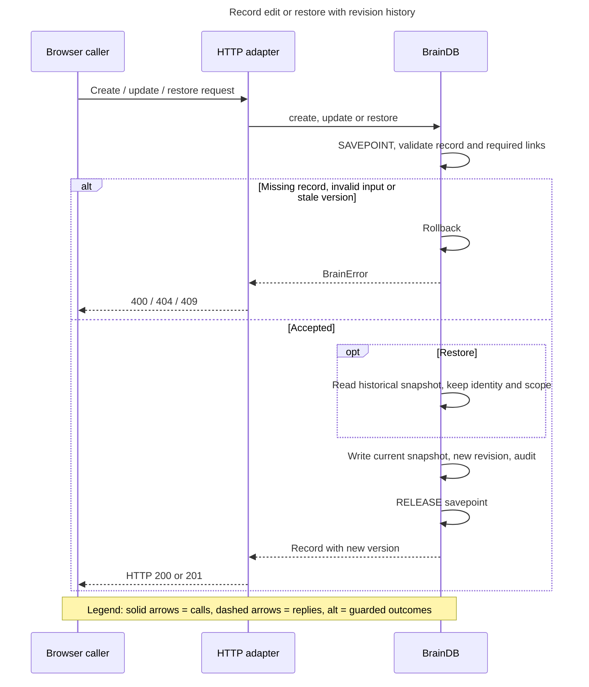

[Sequence](../architecture/diagrams/record-write.mmd). Input validation checks kind/domain/status, title length, content and metadata limits, backend shape and required links. Required dependencies must exist, be active and avoid cycles or foreign project ownership. Update preserves record identity and scope and checks `expectedVersion`. Restore validates the old snapshot but preserves current identity/scope, writes version `current + 1`, and keeps previous revisions. `write` saves snapshot/filter columns, revision and audit in the caller's savepoint. Any error rolls back the operation.

### OP-02 — private personalisation

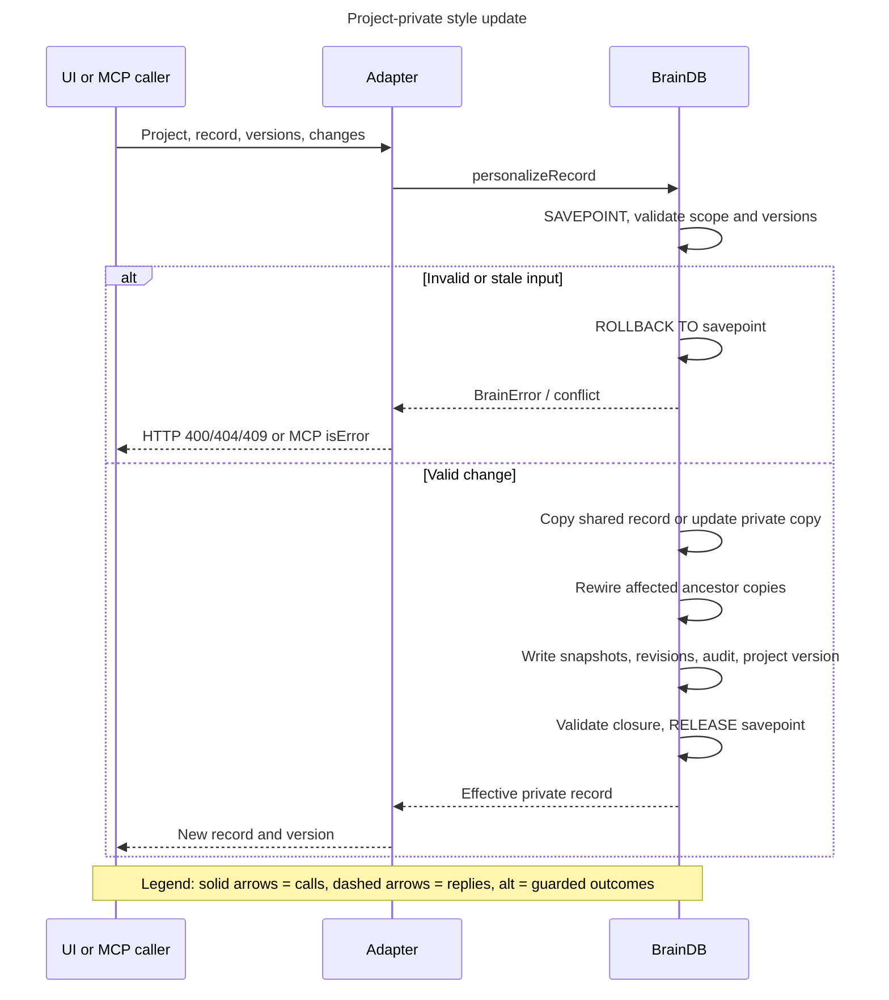

[Sequence](../architecture/diagrams/personalize.mmd). Both expected versions are required. The input must retain active status, kind and domain. A shared record is copied to a UUID with `projectId` and `sourceStyleId`; an existing private copy keeps its identity and increments version. The algorithm recursively copies only ancestors whose exact `requiredIds` must change. It rewrites selected root assignments, clears their old overrides where replaced, increments project version and re-resolves closure before committing. Global and unrelated project records stay unchanged. An unchanged normalised input can return without a new revision.

### OP-03 — resolution, discovery and skill retrieval

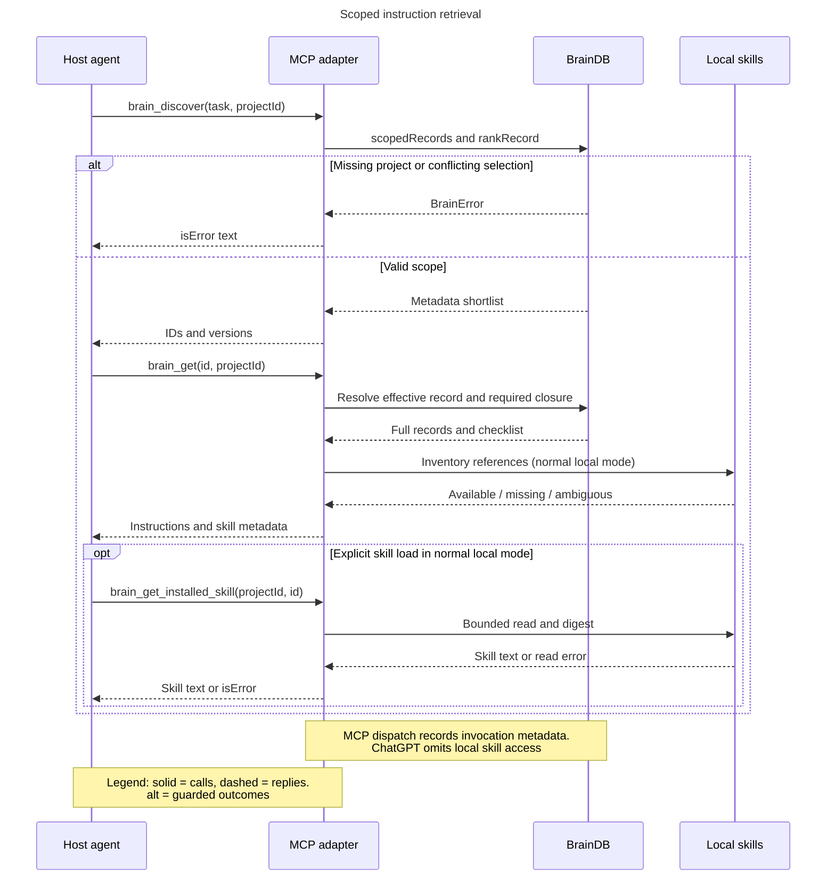

[Sequence](../architecture/diagrams/retrieve.mmd). Scope precedence is explicit project ID, `PB_PROJECT_ID`, nearest ancestor `.personal-brain.json`, then global defaults. Invalid nearest configuration is an error, not permission to silently search farther upward. With a project, `scopedRecords` starts from explicit assignments, applies content overrides and follows exact required IDs, rejecting cycles and slot conflicts. Without scope it returns active shared records only.

Discovery tokenises Unicode-normalised query/fields, removes stop words and sums matches with weights: title 8, tags 6, useWhen 5, summary 3, body/skills/examples/review criteria 1. Priority breaks ties. It returns at most 30 metadata entries, never a full instruction body. `brain_get` requires a selected active ID, loads dependencies and reports installed-skill reference availability. Skill inventory checks project/global/agent/plugin paths; project installations take precedence, differing content digests are ambiguous. Loading reads the current file again; discovery does not execute it.

### OP-04 — preparation

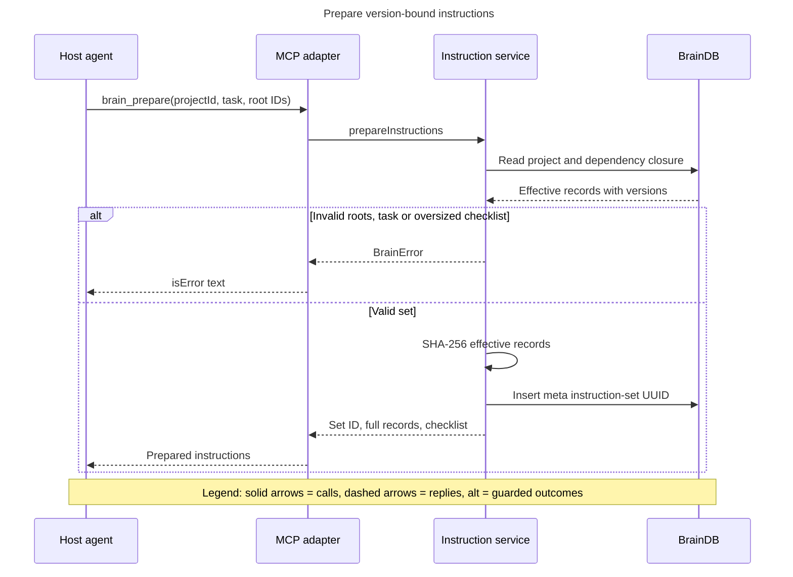

[Sequence](../architecture/diagrams/prepare.mmd). Resolve the selected roots and dependency closure, construct the checklist, SHA-256 the serialised effective records, and save `instruction-set:<uuid>` in `meta`. The stored set contains task, project version, root/resolved IDs, digest and timestamp; the response contains full records. No automatic root selection or compliance judgement is performed.

### OP-05 — artifact review

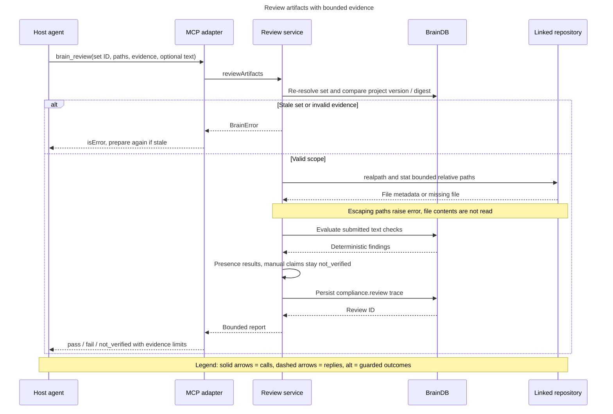

[Sequence](../architecture/diagrams/review.mmd). A prepared set binds project, task, ordered root IDs and digest; project/record drift yields conflict. Legacy explicit task/recordIds review also exists. Evidence must match checklist record ID, version and requirement ID without duplicates. At most 30 relative artifact paths are allowed; absolute paths, traversal, NUL and resolved symlink escapes are rejected. `stat` verifies nonempty regular files and extensions, not their content or editability.

Manual claims of pass remain `not_verified`; explicit fail remains fail. Artifact-presence checks may pass. Submitted text runs deterministic contains/not_contains/min_length/max_length checks, filtered to reviewed records. Omitted text leaves text checks pending. Any failure wins; otherwise outstanding manual/pending checks keep the overall report unverified. The bounded report is persisted as a `compliance.review` event. There is no independent reviewer approval endpoint.

### OP-06 — Fusion

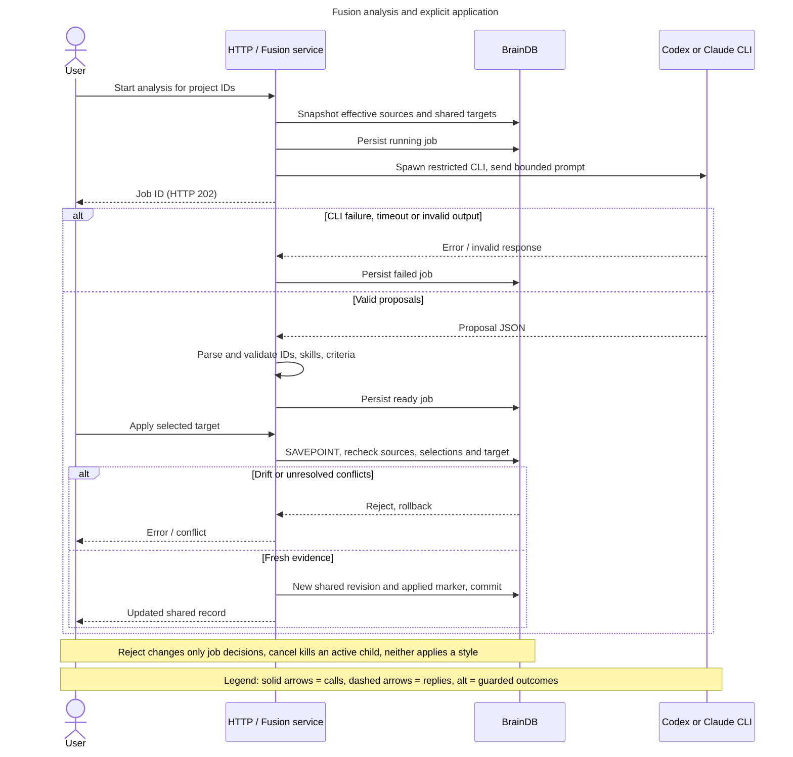

[Sequence](../architecture/diagrams/fusion.mmd), [job state](../architecture/diagrams/fusion-lifecycle.mmd). Input supports 1–30 selected project IDs, retains each project's effective source separately, excludes tool sources, and targets existing active shared preferences. Only one Fusion process runs per server process; this is not a cross-process distributed lock.

The job is persisted before analysis. A temporary directory isolates CLI output. Codex runs with read-only/tool restrictions; Claude runs with tools/MCP disabled. Five-minute timeout and one-million-character output limits bound execution. `parseFusionOutput` accepts a single balanced JSON object surrounded by prose/fences, rejects ambiguous extra JSON, then `validateFusion` verifies target/source IDs, bounded fields, preserved required skills/review criteria and conflicts. A valid result is `ready`, including an empty proposal list.

Apply checks job status, undecided target, source project versions/effective records, target shared version and zero conflicts. Shared update and applied marker share a savepoint. Reject only marks the target rejected. Cancel kills a running child. On reading a persisted running job without an in-memory handle, it becomes failed; there is no automatic resume. Completion callbacks do not recreate a deleted job. Proposal completion is tracked with applied/rejected target arrays; there is no separate `completed` job status.

### OP-07 — onboarding and link

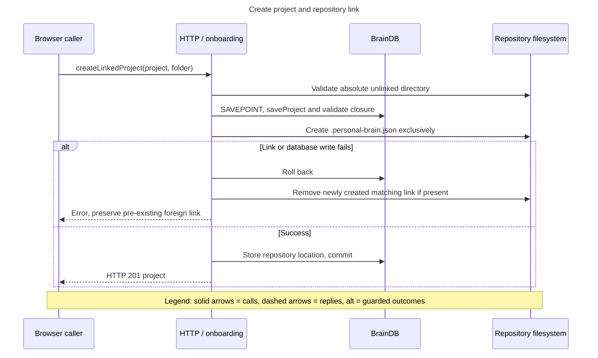

[Sequence](../architecture/diagrams/onboarding.mmd). The folder must be absolute, readable and not already project-linked. A DB savepoint creates and resolves the project before exclusive link-file creation. Repository metadata is then stored. Exceptions roll back SQL and remove only a newly created matching link. Filesystem and SQLite cannot share a true crash-atomic transaction; a process crash between their writes remains a recovery concern.

Optional recommendations are a separate bounded analysis: one analysis per process, default evidence files selected by the scanner (explicit read requests permit up to eight files), catalog input cap and five-minute CLI timeout. Recommendations are validated against allowed styles and are not saved automatically. See [onboarding source](../../src/projects/onboarding.ts) and the recommendation tests in section 11.

### OP-08 — hooks

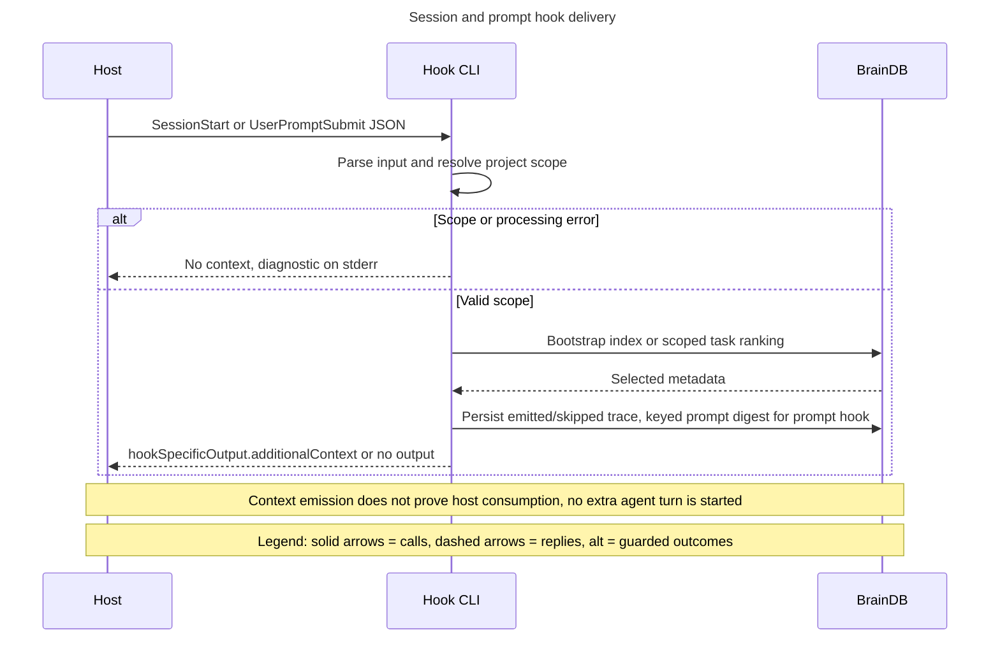

[Sequence](../architecture/diagrams/hook.mmd). Session hooks emit a roughly 1600-character baseline index plus activation guidance. Prompt matching considers the first 4000 characters, adds domain matches to lexical scores and selects bounded metadata by kind. The approximately 1200-character selection budget excludes surrounding guidance, so it is not a total response-size cap. No extra model turn starts. Prompt telemetry stores length and a keyed fingerprint; raw prompts are not stored by ordinary hook tracing. A processing error logs and skips context instead of preventing the user's host task.

### OP-09 — external tool bridge

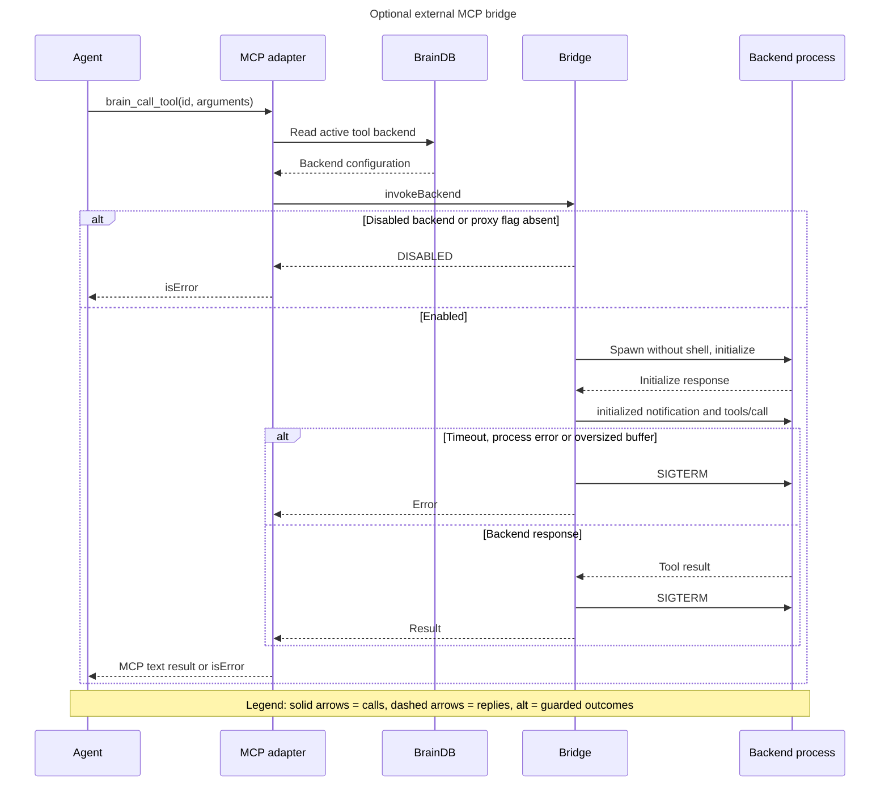

[Sequence](../architecture/diagrams/external-tool.mmd). An active registered tool needs both `backend.enabled` and `PB_ENABLE_TOOL_PROXY=1`. `executable` resolves the program; the bridge spawns with `shell:false`, inherited environment and piped stdio. It sends initialize, initialized notification, then tools/call or tools/list. Default timeout is 30 seconds, configured input clamped to 1–120 seconds; buffer limit is four million characters, retained stderr 1500 characters. Completion/error terminates the child with SIGTERM. No retry, process sandbox or environment-secret filtering is implemented.

### OP-10 — removal/reset

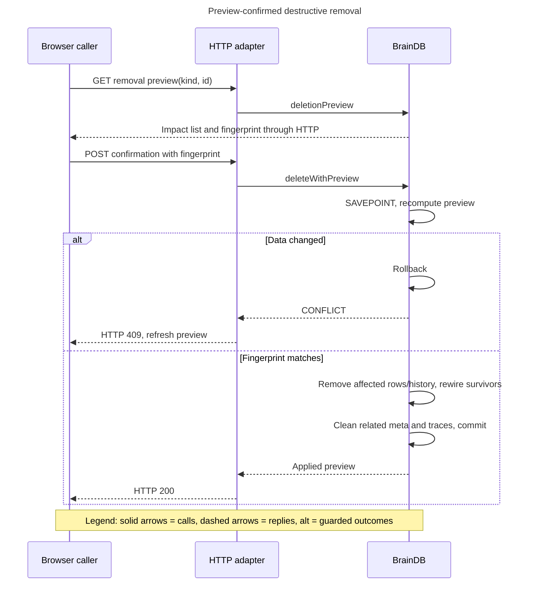

[Sequence](../architecture/diagrams/removal.mmd). Preview fingerprints current relevant state and reports affected records, links and projects. Confirmation recomputes the fingerprint inside a savepoint. A mismatch requires a new preview. Success rewires surviving dependencies, removes affected records/revisions/feedback/audit/trace data, and clears related Fusion/instruction metadata. Project removal preserves shared records; reset restores prior shared selections and removes project-private material. A repository link file can outlive project removal; relinking is a separate filesystem concern. Removal is not revision restore.

## 6. State and lifecycle

[Record lifecycle](../architecture/diagrams/record-lifecycle.mmd): `draft`, `active`, `archived` are eligibility states, not approval stages. Ordinary validated updates can change them; there is no approval-transition guard. Only active records are retrieved for scoped instructions. Private personalisation must stay active. Required links to inactive records make future resolution fail until selections/dependencies are corrected. Revision action is separately `create`, `update` or `restore`.

[Fusion lifecycle](../architecture/diagrams/fusion-lifecycle.mmd): running → ready/failed/cancelled; apply/reject modifies decision arrays while the job stays ready. Retrying creates a new job.

Projects have a version counter and assignments rather than a status machine. Instruction sets have no mutable status field: each review derives freshness from current versions/digest. Review reports are persisted results, not a workflow that transitions to human-approved. Feedback ratings are accepted/rejected/correction and do not mutate styles automatically.

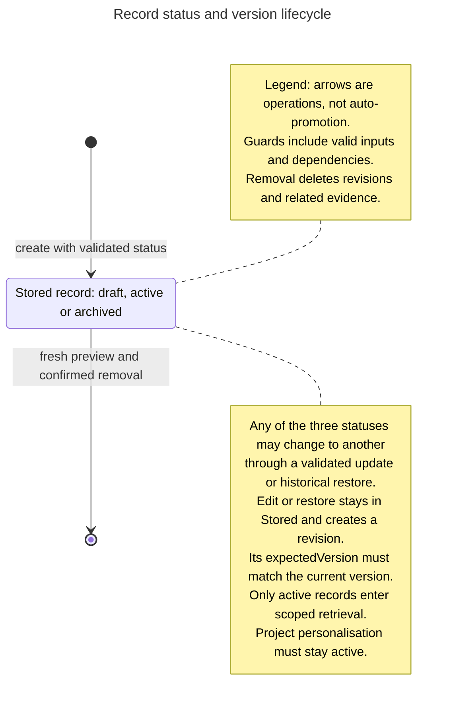

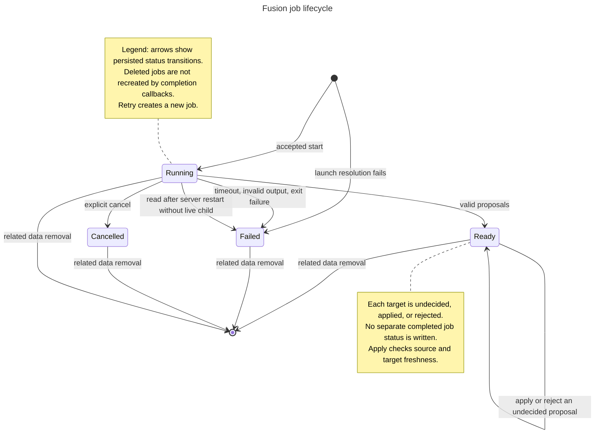

## 7. Data and persistence

The SQLite file owns durable application state. Types and SQL definitions are in [models](../../src/core/models.ts) and [BrainDB](../../src/core/database.ts).

| Table | Identity / stored content | Consistency boundary |
|---|---|---|
| `records` | UUID PK; JSON snapshot plus kind/domain/status/version/updated_at filter columns | With revision and audit on each version write |
| `revisions` | UUID PK; record_id, version, action, JSON snapshot; unique(record_id,version) | Same savepoint as current record |
| `projects` | UUID PK, JSON name/description/assignments/version/time | SaveProject or personalisation transaction |
| `domains` | ID PK; unique case-insensitive name; combinable flag | Domain operation; disabling combination revalidates project selections |
| `feedback` | UUID, optional record reference, rating, note, timestamp | Insert and audit are separate statements; not explicitly wrapped by addFeedback |
| `audit` | UUID, action, target, timestamp, detail | Included in record writes; not an immutable external ledger |
| `meta` | String key PK, string value | Markers, repository mappings, baselines, HMAC secret, Fusion jobs, prepared sets |
| `trace_events` | UUID; time/run/agent/channel/type/outcome; JSON IDs/versions/metadata; demo flag | Each trace insert; not atomic with all business operations |

Relationships in JSON (`requiredIds`, assignments, projectId, sourceStyleId) are validated in code; they are not SQL foreign-key constraints. `PRAGMA foreign_keys=ON` does not create constraints absent from the DDL. Revision uniqueness is enforced by SQL. Indexes cover record filters and trace time/run queries; content discovery scans/deserialises scoped snapshots rather than a full-text index.

`transaction` uses SQLite SAVEPOINT/RELEASE and rollback on exceptions, allowing nested operations. Busy timeout is 5000 ms. Prepared sets and job snapshots live in `meta`; Fusion source snapshots can include complete effective style content. Review report JSON can include explicit task/evidence notes. Ordinary trace privacy guarantees must not be extended to these deliberate submissions.

There is no application record cache requiring invalidation: reads fetch current snapshots. Skill inventories are rescanned; digests detect differing file contents. Fusion's in-memory map contains cancellation handles only; its durable job data is in SQLite. Content/selection drift is checked before apply/review, not hidden by cached objects.

## 8. Error handling

`BrainError` defaults to `INVALID_REQUEST`, HTTP 400; common explicit codes are `NOT_FOUND` 404, `CONFLICT` 409 and `DISABLED` 403. HTTP body accumulation rejects above 180000 JavaScript characters with 413; this is not a byte-count limit. Non-JSON bodies are invalid. Unexpected HTTP exceptions become 500 with a message. The local-only trust assumption matters because messages can expose filesystem details.

Optimistic conflicts require reload and deliberate retry; no automatic overwrite is attempted. Database savepoint failures roll back. Hook failures skip advisory context. External-process failures become failed jobs or MCP errors and require explicit retry. No blanket retry loop is used for non-idempotent writes. The backup command uses `VACUUM INTO` to create a consistent SQLite snapshot, then requests mode 0600.

## 9. Configuration

| Setting | Type/default | Validation and effect |
|---|---|---|
| `PB_HOME` | Path; default `~/.personal-brain-style` | Used directly for DB directory; permissions requested by constructor |
| `PB_PORT` | Number conversion; default 4177 | Passed to Node listen; no dedicated schema/range validator in CLI |
| `PB_PROJECT_ID` | Optional string | Scope resolver checks nonempty value; DB verifies project existence on use |
| `.personal-brain.json` | JSON `{projectId}` | Nearest ancestor; invalid content errors; new links use exclusive create |
| `PB_AGENT` | claude/codex/opencode hint | Recognised values attribute MCP traces; not an authentication boundary |
| `PB_ENABLE_TOOL_PROXY` | Enabled only by exact string `1` | Additional backend.enabled gate required |
| `PB_DEV_RELOAD` | Enabled only by exact string `1` | Development version endpoint and live-reload script injection |
| `CONTROL_PLANE_TUNNEL_ID` | Optional env or prompted string | Tunnel helper validates ID pattern |
| `CONTROL_PLANE_API_KEY` | Optional env or hidden prompt | Nonempty required by helper; never embedded in docs or browser configuration |
| `PATH` / host CLI configuration | OS environment | Executable discovery, host login and skill locations |

Important fixed limits: skill/evidence file 64 KiB; repository read request at most 8 files and 100000 total characters; index page 200 paths; repository traversal depth 12 / 10000 entries; skill scan depth 9 / 6000 visited entries. These bounds and exclusions can produce partial results; callers must inspect returned issues and pagination. No central application config schema is implemented.

## 10. Observability

Event families include `hook.session.context`, `hook.prompt.context`, `hook.prompt.no_match`, `mcp.initialize`, `mcp.tools.list`, `mcp.<tool>` and `compliance.review`. Trace inserts store a whitelist of small metadata, at most 40 record IDs/versions and an optional bounded compliance report. Prompt fingerprints use HMAC-SHA256 with a locally stored random key, truncated to 16 hex characters.

MCP stdout is protocol-only. CLI diagnostics and hook errors use stderr or non-MCP console output. The browser polls trace data; aggregates exclude demo events. A `threadId` can correlate calls when supplied, but absent host linkage does not prove an end-to-end session. There are no OpenTelemetry spans, external metrics endpoint or alert rules in this scope. Existing activity counters are application diagnostics, not billing or compliance metrics.

## 11. Test approach

Tests use Node's test runner, temporary directories and isolated SQLite files. Operation IDs below are documentation mappings to existing tests, not new test-suite names.

| Operation | Existing file and representative test |
|---|---|
| OP-01 | [database.test.ts](../../tests/database.test.ts): “version history and rollback preserve all snapshots”; “invalid records and tool metadata are rejected” |
| OP-02 | [private-styles.test.ts](../../tests/private-styles.test.ts): “project edits clone shared styles and dependent ancestors atomically” |
| OP-03 | [projects.test.ts](../../tests/projects.test.ts): “project dependency closure excludes unrelated global records across MCP and hooks”; [skill-discovery.test.ts](../../tests/skill-discovery.test.ts): inventory bounds and changed-file rescan tests |
| OP-04 | [instruction-set.test.ts](../../tests/instruction-set.test.ts): “prepared instructions bind review to task, project, effective overrides and dependency versions” |
| OP-05 | [artifact-review.test.ts](../../tests/artifact-review.test.ts): “artifact evidence verifies presence, preserves manual uncertainty and rejects unsafe or stale evidence” |
| OP-06 | [fusion-trace.test.ts](../../tests/fusion-trace.test.ts): stale-source/rollback test and “Fusion CLI completes, cancels and does not recreate deleted project history” |
| OP-07 | [onboarding.test.ts](../../tests/onboarding.test.ts): “wizard creates project and repository link together; failed and conflicting attempts preserve data”; bounded recommendation analysis test |
| OP-08 | [hooks.test.ts](../../tests/hooks.test.ts): real CLI hook and bounded index tests; [trace.test.ts](../../tests/trace.test.ts): prompt fingerprint privacy test |
| OP-09 | [mcp.test.ts](../../tests/mcp.test.ts): stdio initialization and exposed tools; enabled external-backend failure/timeout execution is not established by this test and remains a coverage gap |
| OP-10 | [removal.test.ts](../../tests/removal.test.ts): capability/project/reset preservation and fresh-preview tests |
| Packaging | [test-package.mjs](../../scripts/test-package.mjs): offline install, CLI, MCP, hooks, static assets and clean workspace |
| Remote restrictions | [mcp.test.ts](../../tests/mcp.test.ts): “ChatGPT MCP is read-only and pinned to its selected project” |

Use `npm test` with the supported Node runtime from repository root; localhost permission is needed for socket integration tests. Use `npm pack` then `node scripts/test-package.mjs` for package changes. No new runtime tests are introduced by these documentation-only files. The verification report records what was actually run; named tests alone do not assert a current pass.

## 12. Migration and rollout

The DB constructor creates tables/indexes and performs marker-gated legacy changes. Fresh catalog seeding only runs when records, revisions and projects are absent and its marker is missing. It imports catalog dependencies first and preserves an existing user's edited library. HTTP startup also runs compatibility/style upgrade helpers; startup is not a read-only operation.

For a release, create a consistent backup before first launching new code, retain the previous package, run the package smoke check, then restart HTTP and host MCP processes so schemas and paths refresh. Hook/config installation is a separate explicit action. New design files require no DB migration, flags or registration changes.

Rollback of a style uses revision restore and creates a new version. Rollback of executable code alone is not proof an older binary can read a migrated DB. For a full application rollback, stop all writers and restore a compatible pre-upgrade backup together with the previous application, handling WAL sidecars safely. This procedure is a recommendation; an end-to-end recovery drill has not been performed here. Explicit removals cannot be undone from deleted revision rows.

## 13. Open issues

| Issue | Consequence / next decision | Owner |
|---|---|---|
| No assigned design approver or signed requirements baseline | CAP IDs remain derived references; approve requirements separately | Maintainer to assign |
| External tool bridge full-path execution coverage not demonstrated | Add controlled backend fixture if bridge changes | Maintainer to assign |
| Filesystem link and SQLite commit are not crash-atomic | Define repair procedure for orphan links | Maintainer to assign |
| Synchronous scans and snapshot queries lack scale targets | Benchmark expected catalog/repository sizes before scaling | Maintainer to assign |
| MCP handshake version is hard-coded separately from package version | Align version reporting in a future code change | Maintainer to assign |
| No independent review, live tunnel trial or restore drill in this work | Validate before operational claims | Reviewer/operator to assign |
| Current graph paths are stale | Reindex before relying on graph-only impact analysis | Maintainer to assign |

No due dates or approvals have been invented. This draft documents the gaps; it does not silently change application behaviour.
